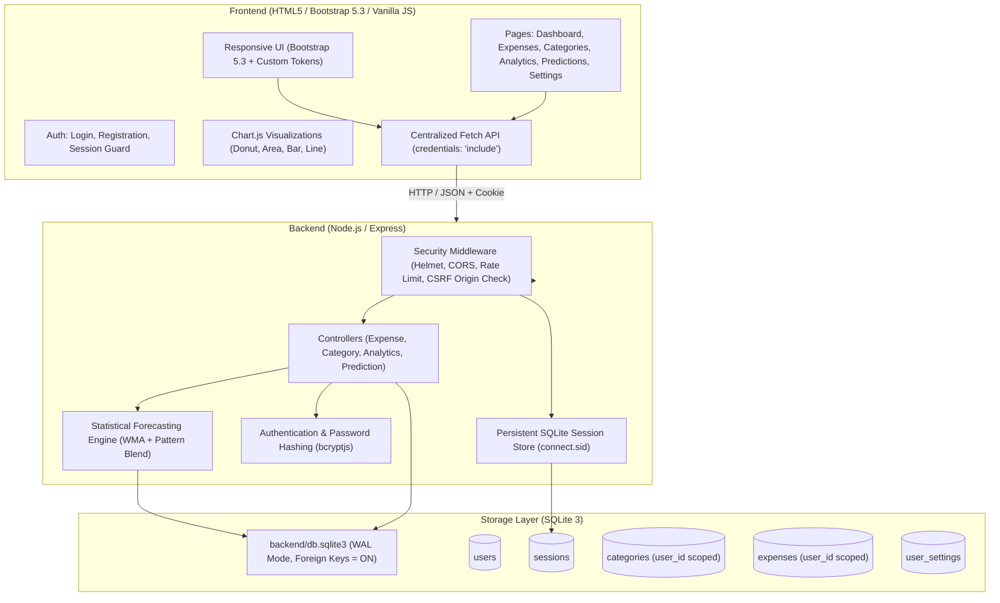

# Personal Expense Analysis and Prediction System
> **Display Name:** Personal Expense Analysis and Prediction System  
> **Short Name / UI Brand:** ExpenseWise

A responsive, local-first, privacy-focused personal finance management and expense forecasting system. Built with an HTML5, CSS3, and Bootstrap 5.3 interface powered by vanilla JavaScript and Chart.js, backed by Node.js, Express, a secure multi-user authentication system, and an embedded SQLite database.

Everything runs on your local machine: **no paid APIs, no third-party tracking, and no external cloud database requirements.**

---

## Architecture Overview



---

## Key Features

| Module | Features & Capabilities |
|---|---|
| **Authentication** | Secure user registration, password strength meter, password hashing (bcrypt), login rate limiting, session regeneration (mitigates fixation), HttpOnly cookies, password change, and session invalidation. |
| **Multi-User Isolation** | All expenses, categories, budgets, settings, and forecasts are strictly scoped to the authenticated user ID at both the database and query layers. |
| **Dashboard** | Summary cards (this month spend, last month spend, remaining budget, average daily spend, projected month-end), 6-month historical trend, category donut chart, daily spending bars, cumulative this-month-vs-last-month line, recent transactions, and generated insights. |
| **Expenses** | Full CRUD, search (title/notes), multi-field filters (date range, category, payment method), server-side pagination, delete confirmation, and CSV spreadsheet export. |
| **Categories & Budgets** | Custom categories, monthly budget caps, custom hex colors, icon picker, expense count badge. Prevents accidental deletion of categories in use via a safe reassignment workflow. |
| **Analytics** | Date range presets (This Month, Last Month, Last 90 Days, This Year, Custom Dates), daily/weekly spending timeline, category distribution, top 5 expense drivers, and budget vs actual performance. |
| **Predictions** | Month-end estimate, next-month forecast, per-category forecasts, historical vs predicted chart, budget overrun warnings, up to 3 data-backed cost-reduction suggestions, and data-sufficiency confidence tiers. |
| **Settings** | Display name, rows-per-page preference (persisted in SQLite), live database status from `/api/health`, and full CSV database export. |

---

## Technology Stack

### Frontend
- **Markup & Layout:** HTML5, CSS3, **Bootstrap 5.3** (grid, forms, tables, modals, dropdowns, utilities)
- **Design System:** Custom CSS design system (forest green `#173F35`, mint `#2F7A5C` / `#DDF3E4`, amber `#F4A261`, and slate neutrals)
- **Scripts:** Vanilla JavaScript with native ES modules (No React, Vite, Vue, Angular, or jQuery)
- **Data Visualization:** **Chart.js** (standalone UMD distribution, zero cloud runtime dependency)
- **Icons:** **Lucide Icons**
- **HTTP Client:** Native Fetch API with `credentials: 'include'`

### Backend
- **Runtime:** Node.js (>= 18 LTS)
- **Web Framework:** Express.js 4.x
- **Database Driver:** `better-sqlite3` (synchronous, high-performance in-process SQLite driver)
- **Authentication & Security:**
  - `bcryptjs` for salted password hashing
  - `express-session` with a persistent SQLite session store
  - `helmet` for secure HTTP response headers
  - `express-rate-limit` to prevent brute-force attacks on `/api/auth/login` and `/api/auth/register`
  - Origin verification for CSRF protection on state-changing requests
- **Validation:** `express-validator`

### Database
- **Location:** `backend/db.sqlite3`
- **Engine:** SQLite 3 with `PRAGMA foreign_keys = ON;` and `PRAGMA journal_mode = WAL;`
- **Schema Migrations:** Idempotent schema initialization; automatic migration of legacy unassigned records to a demo account without data loss.

---

## Database Schema

```sql
CREATE TABLE IF NOT EXISTS users (
  id             INTEGER PRIMARY KEY AUTOINCREMENT,
  name           TEXT NOT NULL,
  email          TEXT NOT NULL UNIQUE COLLATE NOCASE,
  password_hash  TEXT NOT NULL,
  created_at     TEXT NOT NULL,
  updated_at     TEXT NOT NULL
);

CREATE TABLE IF NOT EXISTS sessions (
  sid            TEXT PRIMARY KEY,
  sess           TEXT NOT NULL,
  expired        INTEGER NOT NULL
);

CREATE TABLE IF NOT EXISTS user_settings (
  user_id        INTEGER PRIMARY KEY,
  display_name   TEXT,
  page_size      INTEGER DEFAULT 10,
  theme          TEXT DEFAULT 'light',
  created_at     TEXT NOT NULL,
  updated_at     TEXT NOT NULL,
  FOREIGN KEY(user_id) REFERENCES users(id) ON DELETE CASCADE
);

CREATE TABLE IF NOT EXISTS categories (
  id             INTEGER PRIMARY KEY AUTOINCREMENT,
  user_id        INTEGER,
  name           TEXT NOT NULL,
  color          TEXT,
  icon           TEXT,
  monthly_budget REAL DEFAULT 0,
  created_at     TEXT NOT NULL,
  FOREIGN KEY(user_id) REFERENCES users(id) ON DELETE CASCADE,
  UNIQUE(user_id, name)
);

CREATE TABLE IF NOT EXISTS expenses (
  id             INTEGER PRIMARY KEY AUTOINCREMENT,
  user_id        INTEGER,
  title          TEXT NOT NULL,
  amount         REAL NOT NULL CHECK(amount > 0),
  category_id    INTEGER NOT NULL,
  expense_date   TEXT NOT NULL,
  payment_method TEXT NOT NULL,
  notes          TEXT DEFAULT '',
  created_at     TEXT NOT NULL,
  updated_at     TEXT NOT NULL,
  FOREIGN KEY(user_id) REFERENCES users(id) ON DELETE CASCADE,
  FOREIGN KEY(category_id) REFERENCES categories(id) ON DELETE RESTRICT
);
```

---

## How Predictions Are Calculated

These forecasts are **transparent mathematical and statistical algorithms**, not a black-box machine-learning model:

1. **Pace Baseline:** $\text{Spent to date} / \text{Elapsed days} \times \text{Days in month}$.
2. **Weighted Moving Average (WMA):** Recent completed months, newest weighted highest:
   - 3 completed months: **50% / 30% / 20%**
   - 2 completed months: **60% / 40%**
   - 1 completed month: **100%**
3. **Typical Fraction (Intra-Month Pattern):** Computes the typical fraction of monthly spending completed by day $N$ to correct for front-loaded obligations such as rent paid on the 1st of the month.
4. **Dynamic Month-End Blend:** $\alpha \times \text{pattern} + (1 - \alpha) \times \text{WMA}$, where $\alpha = \text{Elapsed days} / \text{Days in month}$. Early in the month, historical averages dominate; as the month progresses, current month data takes precedence.
5. **Next Month Forecast:** The Weighted Moving Average of completed months.
6. **Data Sufficiency Assessment:**
   - **Preliminary:** $< 3$ completed months (limited baseline).
   - **Moderate:** $3 - 5$ completed months.
   - **Good:** $6+$ completed months.

---

## Quick Start (Windows)

1. **`install.bat`**  
   Verifies Node.js, installs dependencies, initializes `backend/.env`, sets up the SQLite schema, and optionally seeds demo data.
2. **`run.bat`**  
   Starts the backend on port 5000 (serving both API and the Bootstrap frontend), waits for health check, and opens `http://localhost:5000` in your default browser.
3. **`stop.bat`**  
   Safely terminates only the server processes started by this application without touching other Node processes.

### Default Demo Credentials
If demo data is present or migrated:
- **Email:** `demo@expensewise.local`
- **Password:** `Demo@123`

---

## Manual Commands

```bash
# 1. Install dependencies
npm --prefix backend install

# 2. Configure environment (first time only)
copy backend\.env.example backend\.env

# 3. Initialize database
node backend/database/init.js

# 4. Optional: Seed demo data
node backend/database/seed.js

# 5. Run automated test suite
npm --prefix backend test

# 6. Start the server
npm --prefix backend start
# Or for development with live reload:
npm --prefix backend run dev
```

Open `http://localhost:5000` in your browser.

---

## API Reference

All protected endpoints require an active session established via `POST /api/auth/login`.

| Method | Endpoint | Description |
|---|---|---|
| GET | `/api/health` | Health status, uptime, record counts (public) |
| POST | `/api/auth/register` | Register new account & seed default categories |
| POST | `/api/auth/login` | Authenticate & establish session cookie |
| POST | `/api/auth/logout` | Invalidate session & clear cookie |
| GET | `/api/auth/me` | Current user profile & settings |
| POST | `/api/auth/change-password` | Update account password |
| PUT | `/api/auth/profile` | Update display name and rows per page |
| GET | `/api/expenses` | Filtered, searchable, paginated expense list |
| POST | `/api/expenses` | Record a new expense |
| GET | `/api/expenses/:id` | Retrieve single expense |
| PUT | `/api/expenses/:id` | Update expense details |
| DELETE | `/api/expenses/:id` | Remove expense |
| GET | `/api/expenses/export` | Download filtered expenses as CSV |
| GET | `/api/categories` | List user categories with expense counts |
| POST | `/api/categories` | Create custom category |
| PUT | `/api/categories/:id` | Update category color, icon, or budget |
| DELETE | `/api/categories/:id` | Delete category (`?reassign_to=:id` supported) |
| GET | `/api/analytics/dashboard` | Dashboard metrics & chart series |
| GET | `/api/analytics/monthly` | Zero-filled monthly totals |
| GET | `/api/analytics/categories` | Shares, top 5 drivers, budget vs actual |
| GET | `/api/analytics/daily` | Zero-filled daily and weekly series |
| GET | `/api/analytics/comparison` | Like-for-like month comparison |
| GET | `/api/predictions/month-end` | Blended month-end forecast |
| GET | `/api/predictions/next-month` | Next-month forecast and history chart |
| GET | `/api/predictions/categories` | Per-category forecast & budget overruns |
| GET | `/api/predictions/insights` | Data-backed cost-reduction suggestions |

---

## Backing Up & Restoring Data

1. **Spreadsheet Export:**  
   Click **Export all expenses (CSV)** in Settings or the **Export CSV** buttons on the Expenses and Analytics pages.
2. **Database File Backup:**  
   To create an exact byte-for-byte backup of the SQLite database:
   ```cmd
   copy backend\db.sqlite3 backup\db-backup.sqlite3
   ```
3. **Database Restore:**  
   Stop the server (`stop.bat`), copy your backup file over `backend\db.sqlite3`, and restart `run.bat`.

---

## Deployment & Hosting Notes

- **GitHub Repository:**  
  GitHub stores the code repository. GitHub Pages is a static-only web host and **cannot** execute Node.js/Express or provide a writable SQLite database file.
- **Server Deployment (VPS / PaaS):**  
  Deploy to any Node.js hosting platform (e.g. Render, Railway, Fly.io, or an Ubuntu/Debian VPS) with a **persistent volume** mounted for `backend/db.sqlite3`. Set `NODE_ENV=production` and configure a strong `SESSION_SECRET` in environment variables.

---

## Verification & Testing

Run the automated test suite with:
```bash
npm --prefix backend test
```
The test suite performs end-to-end verification across:
- System health
- Unauthenticated route rejection (401)
- User registration, password complexity validation, and bcrypt hashing
- Login authentication, session fixation prevention, and session persistence
- Multi-user data isolation (User B cannot access or modify User A records)
- Expense and category CRUD operations
- Safe category deletion with expense reassignment
- Real-time analytics aggregations and zero-filling
- Statistical prediction formulas and confidence ratings
- CORS origin validation and CSRF protection
